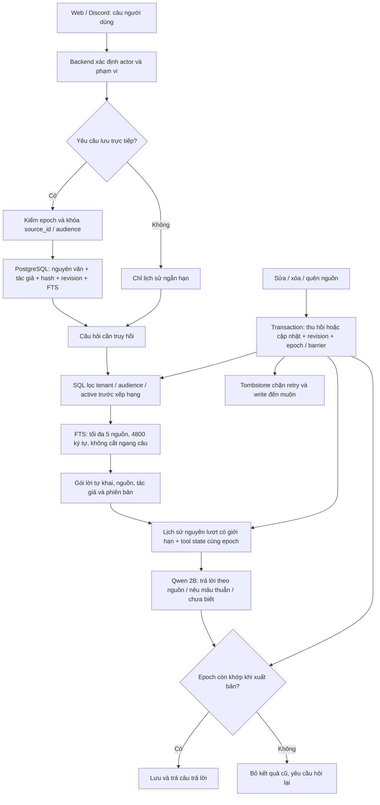

# Memory mới đang chạy trên nhánh thử nghiệm

Nhánh `codex/tool-state-continuity`, gốc `966e6b7`. Đây là mô tả triển khai, không phải tất cả ý tưởng trong blueprint cũ đã được làm xong.

Quyết định chính: **lưu lời người dùng nguyên văn có nguồn và phạm vi; model chỉ đọc và trả lời**. Không cho model viết lại một mệnh đề rồi tự phê duyệt mệnh đề đó. Qwen3.5:2b là reader mặc định; LFM3:1.7b là lựa chọn chủ động. Không có 9B, cloud fallback, teacher hay distillation trên đường chạy này. Registry/pin/raw override được kiểm trước startup probe. Allowlist kiểm tên đã cấu hình; không xác thực lại trọng số bên trong một tag Ollama bị thay thế trái phép.

## Dữ liệu và quyền

- `source_memories`: nguyên văn, hash, tác giả, tenant/audience, revision, trạng thái, type/importance tương thích API và tsvector. Không có một bản sao vector khác chứa câu chuẩn. FTS cập nhật trong cùng transaction với nguồn.
- `source_memory_states`: epoch và mốc bỏ ngữ cảnh cũ. PostgreSQL khóa ngắn khi ghi và xuất bản; không giữ transaction qua cuộc gọi model.
- Web: tenant là tài khoản, audience private. Anonymous và API-key service không gắn tài khoản dùng lane `web:local` của chế độ single-user.
- Discord: đúng guild + channel + thread. Thành viên cùng audience được đọc câu của nhau, luôn kèm tác giả; khác kênh/luồng không được đọc. Chưa mở tìm xuyên kênh dựa trên danh sách ACL của bot.
- Model không chọn actor, guild, channel, thread hay source_id để ghi. Công cụ `remember` bỏ qua `arguments.fact` và kiểm lượt đã lưu.

## Các đường chạy đã nối

1. Web `/memory/add`, `/memory/search`, `/memory/{id}` PUT/DELETE và GET `/memory/notes`; UI Ghi nhớ có lưu nguyên văn, sửa có revision và quên. PUT cần `expected_revision`, bản cũ trả 409; khác chủ thể trả 404. Các API read vẫn theo auth guard của ứng dụng.
2. Web chat và Discord nhận lệnh trực tiếp mở đầu bằng `hãy nhớ`, `ghi nhớ`, `nhớ giúp/hộ/dùm/giùm` hoặc `lưu lại`. Discord tự lưu trước suy luận; không cần reader có gọi đúng tool mới ghi được. Câu chỉ được nói thông thường không tạo note.
3. Lệnh `Hãy quên toàn bộ trí nhớ về tôi` thu hồi các source note của người nói. Web có thể quên một note bằng UI. Discord `search_history` lọc đúng channel/thread và mốc vô hiệu hóa; công cụ kho nhãn/jokes cũ không được đăng ký trong mode mới.
4. Sự kiện sửa/xóa raw message thu hồi source note trong cùng transaction. Delete/edit đến trước record vẫn để dấu chặn theo source_id. Sửa note qua web tạo revision mới; sửa tin Discord không tự phê duyệt nội dung mới, cần một yêu cầu lưu mới.
5. Không chèn `DiscordMemory` cũ, nhãn đã duyệt cũ hay recap cũ vào mode mới. Migration tạo mốc khởi đầu cho các tenant đã tồn tại; không tự nhập các fact cũ không đủ provenance vào v2.
6. Lịch sử chat và RAG rewrite bỏ dữ liệu trước barrier. Trạng thái công cụ dùng scope có epoch; cắt lịch sử giữ trọn lượt và sửa lại chỉ số anchor tương ứng. Giữ cơ chế kiểm độ mới tài liệu của nhánh gốc.
7. Chat/RAG kiểm epoch trước khi lưu kết quả; thay đổi trong lúc suy luận làm kết quả cũ bị bỏ cùng trace/tool state. SSE của v2 được đệm tới bước kiểm này. Retry delivery Discord kiểm lại nguồn đã bị vô hiệu hóa.
8. `scripts/forget_member.py --apply` gọi thu hồi v2 trước khi xử lý các bản sao legacy. Default ingestion/extractor/verifier/condenser không tham gia mode v2.

## Một câu đi qua đâu?

**“Hãy nhớ tôi không thích cà phê đen, tôi thích trà xanh.”**

`DiscordTurnService.execute` → `discord.source_memory.prepare_turn` → nhận actor/audience từ session/turn → kiểm yêu cầu trực tiếp → `SourceMemoryService.save(expected_epoch=...)` → khóa và ghi nguyên câu vào PostgreSQL → biên nhận backend → reader trả lời.

Lượt sau **“Tôi có thích cà phê đen không?”** → `SourceMemoryService.context` → FTS trong đúng audience → câu nguyên văn cùng author/source_id/revision → Qwen 2B trả lời “Theo lời bạn đã lưu, không thích…” → kiểm epoch → lưu câu trả lời.

Nếu đổi sang kênh khác: câu nguồn bị loại ngay trong SQL. Nếu nguồn bị xóa/quên: FTS không còn nội dung đó, lịch sử trước barrier và tool state epoch cũ không được dùng. Nếu một write đã kiểm intent nhưng đến sau thao tác quên: `expected_epoch` cũ bị từ chối.

## So với memory cũ

| Tiêu chí | Luồng cũ | Luồng mới |
|---|---|---|
| Ghi nhớ trực tiếp | Model chọn `fact`, kiểm số và tỉ lệ từ trùng; có thể bỏ chữ “không” | Backend lưu toàn câu nguồn; fact do model đưa không có quyền ghi |
| Học tự động | Extractor/verifier và auto-apply có thể sinh fact | Chỉ note được yêu cầu rõ; chưa suy diễn fact tự động |
| Quyền Discord | Một số luồng memory/history đọc cả guild | Audience đúng channel/thread; tác giả được giữ |
| Tính nhất quán | PG + Qdrant mirror, có đường đọc payload cũ | Một nguồn PG + chỉ mục FTS transaction; không có mirror memory v2 |
| Lưu/quên đến muộn | Các bản sao/lịch sử có thể chứa lại nội dung | Tombstone + expected_epoch + barrier + kiểm xuất bản |
| Model | Registry cũ có 9B ở nhiều vai trò | Qwen 2B mặc định, LFM 1.7B lựa chọn; OCR GLM; vision off; không author model |
| Truy hồi ý tương đồng | Có dense retrieval | FTS chuẩn hóa tiếng Việt; yếu hơn với đồng nghĩa/paraphrase |
| Chi phí | Có embedding/generation trên nhiều đường | Ghi/tìm memory không gọi model hoặc embedding; reader vẫn cần inference |

## Phạm vi chất lượng và đánh đổi

- Đây là bản source-note có thể kiểm nguồn, chưa phải bộ hiểu ngữ nghĩa hoàn chỉnh: chưa có typed slots, tự hợp nhất facts, quan hệ nhiều người, phát hiện mâu thuẫn bằng thuật toán hay thay thế fact bằng suy luận. Không tự coi câu mới nhất là đúng.
- Quên toàn bộ tăng barrier chung của tenant để tránh trích dẫn gián tiếp ở kênh chưa từng được truy vấn. Sửa/quên một note vô hiệu hóa lịch sử cũ của audience. Đây là cách thận trọng, làm giảm nhớ lại các đoạn hội thoại liên quan; các source note khác vẫn có thể truy hồi.
- Thu hồi sử dụng trong context không phải secure erasure toàn bộ transcript, request log, backup hay tin đã gửi ra Discord. Script forget_member vẫn phục vụ dọn các bản sao legacy theo quy trình sẵn có.
- Budget 4800 là ký tự, và ngân sách lịch sử là ước lượng ký tự theo cửa sổ model; chưa phải chứng minh số token tuyệt đối. Note dài không vừa budget bị bỏ nguyên câu; API list vẫn xem/sửa được.
- Dữ liệu rất lớn, đồng nghĩa, xuyên kênh có ACL và truy hồi dày đặc cần eval riêng. Nếu thêm vector, phải có outbox bền vững + version check + canonical re-read; không được đưa payload vector thẳng vào prompt.
- Sáu ca Qwen 2B là smoke test tổng hợp đã chỉnh prompt trên cùng tập; không chứng minh tốt nhất thị trường hay parity model cũ. Bằng chứng và cả các lần thất bại ở `data/evaluation/results/kept/memory-v2-source-20261109/`.

## Dùng thử và quay lại

`SOURCE_MEMORY_ENABLED=true` là mặc định của nhánh. Cần migration `20261109_39` trước khi chạy backend vào database thử nghiệm. Không tự chạy migration hoặc launcher với dữ liệu đang hoạt động trong tác vụ này. `SOURCE_MEMORY_ENABLED=false` cho phép đối chiếu luồng legacy; policy model nhỏ vẫn chặn 9B. Không rollback schema nếu cần giữ source note; dùng flag để tắt mode.

Registry chỉ có lựa chọn small-model hiện hành. Pin cũ như `MODEL_VERSION_GENERAL=general-v0` sẽ bị từ chối rõ, không âm thầm đổi model. OCR GLM được định tuyến nhưng chưa được đánh giá OCR lại trong thí nghiệm memory này. Không tải model, push nhánh, merge main hoặc triển khai production trong tác vụ này.

## Ghi chú kiểm chứng cuối

Sáu ca mới được khóa trước khi chạy với prompt không đổi cho kết quả 5/6 đúng ý chính.
Ca vai trò Redis/PostgreSQL vẫn từ chối quá mức dù đã lấy đúng câu nguồn; không sửa
prompt rồi gọi lại tập này là heldout. Chi tiết ở `fresh-cases.json`.

AI chat/RAG của v2 chỉ dùng hội thoại của đúng chủ đang gọi. Quyền admin xem transcript
có sẵn không được biến thành quyền mượn ngữ cảnh AI với một epoch khác chủ. Transcript,
log và các bản sao đã gửi không nằm trong cam kết xóa vật lý của việc thu hồi một note.

GLM OCR giữ recipe `data/models/ocr/ocr-v1/Modelfile` và cấu hình đã có; tag custom đang
được cài trên máy. Trên máy mới, cần làm bước chuẩn bị GGUF bằng hướng dẫn build OCR;
không có fallback OCR 9B. Danh sách hub pull của profile chỉ gồm general 2B và embedding
0.6B; recipe OCR đi qua danh sách create. Tác vụ này không tải hay build lại trọng số OCR.
